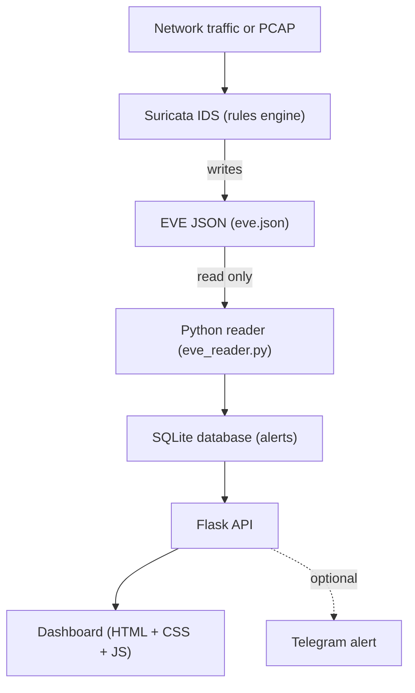

# CyberGuard

### A Suricata-Powered Network Intrusion Detection and Monitoring System

CyberGuard is a university Information Security project. It watches network
traffic and shows security alerts on a simple web dashboard.

The key idea is simple: **Suricata is the only detection engine. Python never
detects anything.** Suricata reads the traffic, checks it against rules, and
writes alerts. Python only reads those alerts, stores them, and shows them. If
Suricata stops, new alerts stop too.

> **What is an IDS?** An IDS (Intrusion Detection System) is a tool that watches
> traffic and raises an alert when it sees something suspicious. It only warns.
> It does not block.

---

## Goal

Build a clear, beginner-friendly security monitor where:

- **Suricata** does all the detection.
- **Python** reads the alerts, saves them, and serves a small API.
- A **dashboard** shows the alerts in the browser.

The project was built step by step, in 8 phases.

---

## Architecture



**Data flow in words:**

1. Traffic arrives on the network interface.
2. Suricata checks each packet against the rules.
3. When a rule matches, Suricata writes an alert to **EVE JSON**.
4. Python reads the new alert lines from that file.
5. Python stores each alert in **SQLite**.
6. The **Flask API** serves the alerts as JSON.
7. The **dashboard** fetches the API and shows the alerts.
8. If Telegram is turned on, Python sends a short message for new alerts.

> **EVE JSON** is Suricata's output file. It has one JSON object per line. Each
> line is one event (for example, an alert).

**Key principle:** detection logic lives only in Suricata rules. Python never
decides what is an attack. It only shows what Suricata found.

---

## Technology stack

| Layer            | Technology                         | Why                                  |
|------------------|------------------------------------|--------------------------------------|
| Detection engine | Suricata IDS 8.0.7                  | The only tool that inspects traffic. |
| Engine host      | Kali Linux 2026.3 (VirtualBox VM)  | A Linux box to run Suricata.         |
| Backend          | Python 3, Flask                    | Reads EVE JSON and serves the API.   |
| Storage          | SQLite                             | A small file database, no server.    |
| Frontend         | HTML, CSS, vanilla JavaScript      | A simple dashboard, no framework.    |
| Data format      | EVE JSON                           | Suricata's alert output.             |
| Notifications    | Telegram Bot API (optional)        | Sends a message for new alerts.      |

We did not use React, Docker, Redis, or cloud services. We kept it small and
easy to read.

---

## Features

- Reads real Suricata alerts from EVE JSON (never fake alerts).
- Stores alerts in SQLite with no duplicates.
- A Flask API: status, alerts (with filters), stats, and rules.
- A dark SOC dashboard: cards, a severity chart, top lists, and an alert table.
- Honest engine status: it never says "running" unless it checked the process.
- A **Rule Lab** page that shows the rules file (read only).
- Optional Telegram alerts for new, serious alerts.
- 57 automated tests that run with no Suricata and no network.

> **SOC** means Security Operations Center. It is the team or room where people
> watch security alerts. Our dashboard copies that style.

---

## Repository structure

```
cyberguard-suricata-ids/
├── app/                      Flask application
│   ├── config.py               environment-based settings
│   ├── __init__.py             app factory + routes
│   ├── main.py                 entry point (serve / ingest-once / telegram-test)
│   ├── services/
│   │   ├── eve_reader.py        reads EVE JSON (incremental, safe)
│   │   ├── alert_service.py     normalize, store, status, worker
│   │   ├── rule_service.py      read-only rules file parser
│   │   ├── telegram_notifier.py optional Telegram alerts
│   │   └── database.py          SQLite tables and queries
│   ├── templates/              index, alerts, rule_lab pages
│   └── static/                 css + dashboard.js
├── suricata/rules/           cyberguard.rules (source of truth)
├── lab/                      harmless local test server + lab notes
├── scripts/                  start_lab.sh, e2e_test.sh, rule_toggle_experiment.sh
├── tests/                    pytest tests (57 total)
├── docs/                     architecture, demo guide, Q&A, report, slides
├── data/                     runtime DB / EVE JSON (git-ignored)
├── .env.example              placeholder settings (no secrets)
├── CLAUDE.md                 permanent build instructions
└── PROJECT_MEMORY.md         detailed project memory
```

---

## Installation (on the Kali Linux VM)

Suricata runs only on the Kali VM. These steps were done and checked on that VM.

1. Install Suricata from the Kali repo:
   ```bash
   sudo apt install -y suricata
   suricata -V        # shows Suricata 8.0.7 RELEASE
   ```
2. Copy our rules to Suricata's rules folder and point the config at them:
   ```bash
   sudo cp suricata/rules/cyberguard.rules /var/lib/suricata/rules/cyberguard.rules
   # In /etc/suricata/suricata.yaml, set the rule-files entry to: cyberguard.rules
   sudo suricata -T -c /etc/suricata/suricata.yaml -v   # test: 2 rules loaded, 0 failed
   ```
3. Set up Python:
   ```bash
   python3 -m venv .venv
   source .venv/bin/activate
   pip install -r requirements.txt
   ```
4. (Optional) copy the settings template and edit your local `.env`:
   ```bash
   cp .env.example .env    # .env is git-ignored; never commit it
   ```

---

## How to run (3 terminals on the Kali VM)

Open three terminals in the project folder.

**Terminal 1 — the harmless lab web server** (gives Suricata some HTTP traffic):
```bash
python3 lab/server.py --port 8000
```

**Terminal 2 — the CyberGuard backend** (API + reader on http://127.0.0.1:5000):
```bash
python -m app.main
```

**Terminal 3 — Suricata on the loopback interface** (needs sudo):
```bash
sudo suricata -c /etc/suricata/suricata.yaml -i lo -D --pidfile /tmp/suricata.pid
```

Then open http://127.0.0.1:5000/ in Firefox on the VM.

To test a detection, send a request that matches a rule:
```bash
curl http://127.0.0.1:8000/cyberguard-test      # -> alert sid 1000001
curl http://127.0.0.1:8000/cyberguard-warning   # -> alert sid 1000002
curl http://127.0.0.1:8000/index.html           # -> no alert (benign)
```

---

## API

All responses are JSON. The server stays on `localhost`.

| Method & path     | What it returns                                                        |
|-------------------|------------------------------------------------------------------------|
| `GET /api/health` | Liveness of the Flask API itself (not the engine).                     |
| `GET /api/status` | Honest status: engine process, EVE file, counts, Telegram state.       |
| `GET /api/alerts` | Stored alerts, newest first. Filters: severity, signature, src_ip, date, paging. |
| `GET /api/stats`  | Totals: by severity, by signature, by source IP, last 24h.             |
| `GET /api/rules`  | Read-only view of the rules file (not proof the engine loaded it).     |

**Example `GET /api/alerts` item** (fields from a real alert; values shown as an
example):
```json
{
  "timestamp_utc": "2026-11-09T14:46:33.623977+00:00",
  "flow_id": 420878223340296,
  "src_ip": "127.0.0.1",
  "src_port": 46988,
  "dest_ip": "127.0.0.1",
  "dest_port": 8000,
  "proto": "TCP",
  "app_proto": "http",
  "signature": "CyberGuard Test Alert",
  "signature_id": 1000001,
  "severity": 1,
  "category": "uncategorized",
  "action": "allowed",
  "http_url": "/cyberguard-test",
  "http_method": "GET",
  "http_status": 200,
  "in_iface": "lo"
}
```

The API never returns the raw EVE line. It never runs commands. It never takes a
file path from the request.

---

## Testing

- **Unit tests:** run on Windows with no Suricata and no network.
  ```bash
  pytest -q      # 57 passed
  ```
- **End-to-end test (Kali VM):** sends real traffic and checks the API.
  ```bash
  bash scripts/e2e_test.sh      # prints a PASS/FAIL table, exit 0 on success
  ```
- **Rule toggle experiment (Kali VM):** proves detection depends on the rule.
  ```bash
  bash scripts/rule_toggle_experiment.sh
  ```
  When the rule is off, no new alert appears. When the rule is back on, the alert
  appears again. This shows the detection is real, not faked by Python.

---

## Security notes

- CyberGuard is an **IDS**. It only detects and warns. It does not block (no IPS).
- All tests run in an **authorized local lab** with harmless markers.
- The Flask app stays on **localhost**. It is not exposed to the internet.
- No API route **runs shell commands** or reads a path from the request.
- The dashboard is **XSS-safe**: it renders all text with `textContent`, not HTML.
- The Telegram **token lives only in a local `.env`** (git-ignored). It is never
  committed, logged, or shown in the API.

> **XSS** means Cross-Site Scripting. It is an attack where bad text becomes code
> in the page. We avoid it by never putting alert data into raw HTML.

---

## Known limitations

- Suricata captures on **loopback (`lo`) only**. Other interfaces are not watched.
- There are only **2 custom rules** (a test alert and a warning alert).
- It is **IDS only**. It does not block traffic (no IPS mode).
- The **rate-limit summary** and **token revocation** are only tested with mocked
  unit tests, not live on the VM.
- It uses the **Flask development server**. It is not hardened for production.
- The dashboard has **no login**. It is safe only because it stays on localhost.

---

## Screenshots

Screenshots live in `docs/screenshots/` (see
[`docs/screenshots/README.md`](docs/screenshots/README.md) for the list). They were
taken on the Kali VM.

> Note: Numbers in the screenshots come from later runs than the numbers in the text.

- [`01-dashboard-overview.png`](docs/screenshots/01-dashboard-overview.png) — the SOC dashboard: cards, severity chart, and "SURICATA RUNNING (verified)".
- [`02-alert-detail.png`](docs/screenshots/02-alert-detail.png) — the alert detail panel with all fields.
- [`03-rule-lab.png`](docs/screenshots/03-rule-lab.png) — the Rule Lab page with both rules.
- [`04-e2e-pass-table.png`](docs/screenshots/04-e2e-pass-table.png) — `e2e_test.sh` showing PASS 4 / FAIL 0.
- [`05-rule-toggle-summary.png`](docs/screenshots/05-rule-toggle-summary.png) — `rule_toggle_experiment.sh` SUMMARY.
- [`06-telegram-alerts.jpg`](docs/screenshots/06-telegram-alerts.jpg) — the two Telegram alert messages.
- [`07-suricata-not-running.png`](docs/screenshots/07-suricata-not-running.png) — the dashboard with the "NOT RUNNING" banner.

---

## More documentation

- [`docs/architecture.md`](docs/architecture.md) — components and data flow.
- [`docs/demo-guide.md`](docs/demo-guide.md) — a 10-minute live demo script.
- [`docs/professor-qa.md`](docs/professor-qa.md) — likely questions and answers.
- [`docs/technical-report.md`](docs/technical-report.md) — the full report.
- [`docs/presentation.md`](docs/presentation.md) — the slide outline.
- [`PROJECT_MEMORY.md`](PROJECT_MEMORY.md) — detailed project memory.
